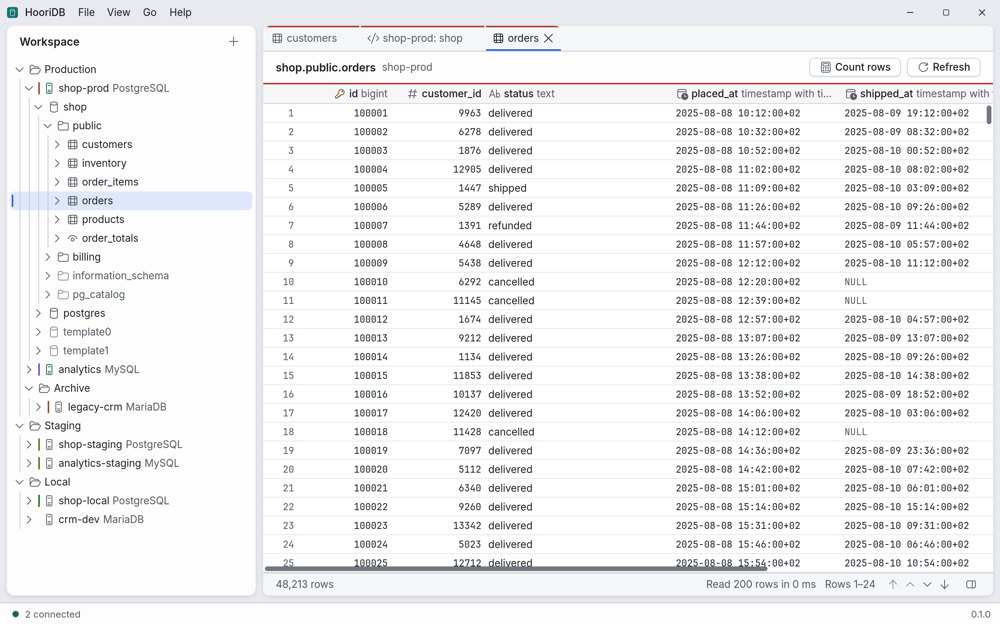
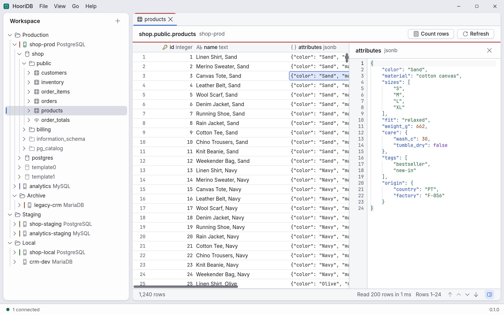
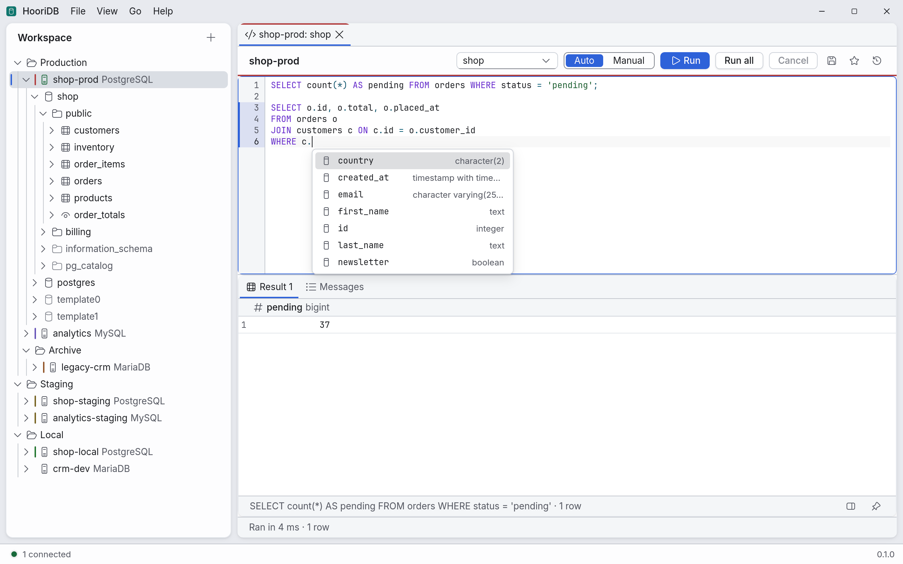
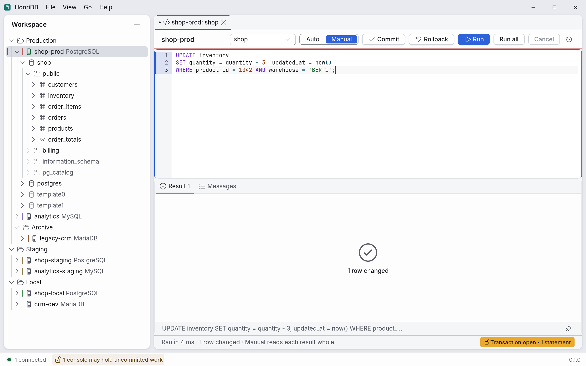
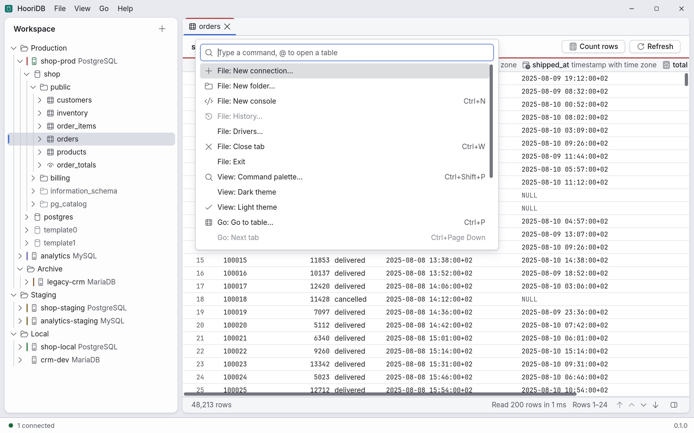

<p align="center">
  
</p>

# HooriDB

A desktop database manager for PostgreSQL, MySQL, MariaDB, and MongoDB on Windows 11 and Linux (x64), written in Java with the GPU-rendered UI framework [rethinkj UI](https://ui.rethinkj.com).

[Website](https://db.hoori.dev) · [Docs](https://db.hoori.dev/docs) · [Download](https://github.com/hooridev/HooriDB/releases)

<picture>
  <source media="(prefers-color-scheme: dark)" srcset="docs/public/shots/overview-dark.webp">
  
</picture>

## Status

Early development. Only nightly builds are published so far as pre-releases on [GitHub Releases](https://github.com/hooridev/HooriDB/releases). You can browse schemas and collections, read table rows and documents, and run SQL or MongoDB shell statements, but you cannot edit, filter, or sort rows in the table grid yet. See [Limitations](https://db.hoori.dev/docs/reference/limitations) for what is not supported yet.

## Features

- **Workspace**: Organize connections in nested folders, mark tree rows and tabs with one of ten colors, store passwords in the system keyring, and move items without disconnecting open connections.
- **Schema browser**: Connect to multiple servers at once and expand databases, schemas (PostgreSQL), tables, views, and columns on demand.
- **Table data**: Read table and view rows in pages as you scroll or use paging buttons, and inspect cells in a side value panel that formats and colors JSON, marks syntax errors, and loads shortened table values whole by primary key when the table has one.
- **SQL console**: Run the statement at the caret, a selection, or all statements on a dedicated connection with keyword and object completions, inline error underlines, pinned result tabs, and a Messages log; open consoles are restored unconnected on the next start.
- **MongoDB**: Browse databases, collections, and sampled document fields, view documents as a grid, Relaxed Extended JSON, or a tree, and run shell statements (`find`, `aggregate`, write methods, indexes, `runCommand`, and more) in a console with completions; connections can be set to read-only so HooriDB sends only read commands.
- **Transactions**: Switch each SQL console between Auto and Manual commit, commit or roll back open transactions, and get prompted before closing tabs, switching databases, disconnecting, exiting, or running an `UPDATE` or `DELETE` without `WHERE` (or `LIMIT` on MySQL and MariaDB).
- **Statement history**: Keep up to 1,000 recent statements per connection, search them, insert them back into a console, or clear them.
- **Command palette**: Run menu commands from the keyboard (`Ctrl+Shift+P` or `F1`) and jump to tables and views by name (`Ctrl+P`, or `@` in the palette), loading unread databases on demand.
- **Tabs and windows**: Reorder tabs, drag them out or move them into separate windows, and switch between dark and light themes.
- **Driver management**: Download official PostgreSQL, MySQL, and MariaDB JDBC drivers and the MongoDB Java driver from Maven Central after confirmation, verify checksums, and list or delete downloaded versions in **File > Drivers…**.
- **Built-in updates**: Check GitHub Releases on startup when running from an installed app image, switch between Stable and Nightly channels in **Help**, and roll back automatically if a new version fails to show its first frame.

| | |
| --- | --- |
| <picture><source media="(prefers-color-scheme: dark)" srcset="docs/public/shots/value-panel-dark.webp"></picture> | <picture><source media="(prefers-color-scheme: dark)" srcset="docs/public/shots/completion-dark.webp"></picture> |
| <picture><source media="(prefers-color-scheme: dark)" srcset="docs/public/shots/transaction-dark.webp"></picture> | <picture><source media="(prefers-color-scheme: dark)" srcset="docs/public/shots/palette-dark.webp"></picture> |

## Install

Each release on [GitHub Releases](https://github.com/hooridev/HooriDB/releases) bundles its own runtime (no separate Java installation needed) and includes a `SHA256SUMS` file.

**Windows**: Requires Windows 11 or later (x64) with a Direct3D 12 graphics adapter. Run `HooriDB-<version>-windows-x64-setup.exe` to install for your user account into `%LOCALAPPDATA%\Programs\HooriDB` without administrator rights, or extract `HooriDB-<version>-windows-x64.zip` into a writable folder and run `HooriDB.exe`.

**Linux**: Requires Linux (x64) with glibc 2.38 or later and a Vulkan graphics adapter. Extract `HooriDB-<version>-linux-x64.tar.gz` into a writable folder (such as `~/.local/opt`) and run `~/.local/opt/HooriDB/bin/HooriDB`; starting from the unpacked bundle writes a desktop entry to `$XDG_DATA_HOME/applications/dev.hoori.db.desktop`.

See [Install](https://db.hoori.dev/docs/get-started) for full instructions and requirements.

## Build from source

Requires JDK 25 and Maven 3.9 or later (there is no Maven Wrapper). The first build downloads rethinkj UI and its platform native JARs from Maven Central Snapshots and requires network access; nothing native is compiled locally.

```sh
mvn verify                                # build and test everything
mvn -q -pl app -am compile exec:exec      # start the app in a window
mvn spotless:apply                        # format the Java code
mvn -Pbundle verify                       # build the release bundle for this platform
```

| Directory | Artifact | Purpose |
| --- | --- | --- |
| `core/` | `hooridb-core` | Connections, metadata, and queries (no UI dependencies). |
| `app/` | `hooridb-app` | Desktop app: state, views, and windows (`dev.hoori.db.app.HooriDb`). |

The website and documentation live in `docs/` (requires Node.js 24 or later):

```sh
cd docs && npm ci && npm run dev
```

## Contributing

Bug reports and pull requests are welcome on [GitHub](https://github.com/hooridev/HooriDB). Use [Conventional Commits](https://www.conventionalcommits.org/) for commit messages and run `mvn spotless:apply` before committing (`mvn verify` checks formatting). See [AGENTS.md](AGENTS.md) for code, testing, and release conventions.

## License

MIT License. Copyright (c) 2026 Patrick Trautmann and the HooriDB contributors. See [LICENSE](LICENSE).
